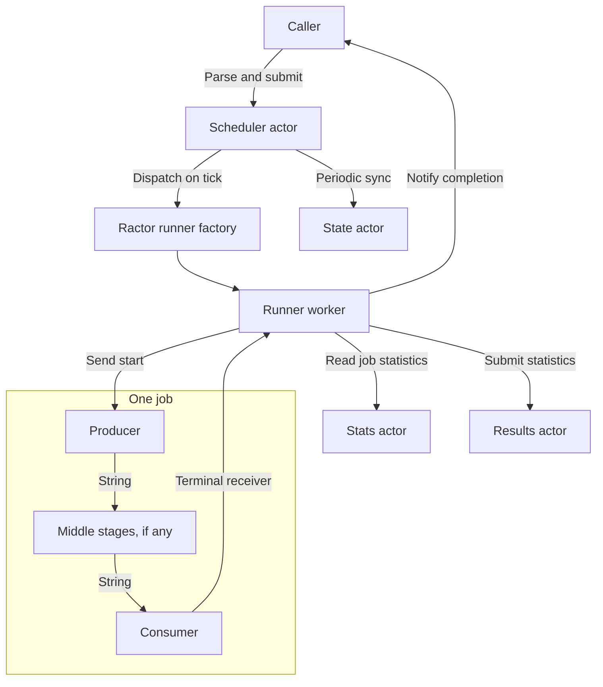

# Engine pipeline design

This document describes the pipeline in the `fetiche-engine` crate. See [Architecture](../../docs/ARCHITECTURE.md) for
the broader repository layout. The implementation under [
`../../cmd/fetiched/src/engine`](../../cmd/fetiched/src/engine/mod.rs) has its own execution path and is outside this
document's scope.

## Authoritative completion

The architecture review below records the baseline that motivated the first two improvements, which are now implemented.
The runner now drains terminal output while monitoring every stage's Tokio join handle. Success requires all stages to
return successfully. A stage error or panic records the stage's position and name, aborts remaining stages, and waits for
their tasks to exit. Cancellation reported by a task has its own status. Output written before a failure is retained.

`WaitGroup::rx` is now a Tokio oneshot receiver for `JobOutcome`, which carries the job ID, terminal status, and
statistics snapshot. The results actor acknowledges storage before the caller is notified on the normal path.
`Work` dropped before publication reports cancellation directly to its waiter.
`submit_job_and_wait` still returns statistics on success and reports failed or cancelled outcomes as errors.

[Runner](../src/actors/runner.rs), [Outcome types](../src/job.rs), [Results](../src/actors/results.rs)

## Backpressure and blocking work

Pipeline edges use bounded Tokio MPSC channels. A full edge suspends the sending stage or source adapter until its
receiver makes room. Each stage inherits its input channel's capacity when it creates the next channel. Senhive
requests an AMQP prefetch of one delivery per feed to limit buffering ahead of the pipeline.

Set these optional values at the top level of `engine.hcl`. The example shows the defaults.

```hcl
pipeline_queue_capacity = 16
read_max_bytes          = 67108864
```

`pipeline_queue_capacity` limits queued messages per edge. The default is a starting point. Use representative
message sizes and sink throughput when tuning it. A stage can also hold an in-flight message. Network fetchers can
materialize a full source response, so the queue capacity does not establish a job-wide byte limit.

A `Read` stage sends one UTF-8 payload to preserve the file boundaries expected by consumers such as `Save`.
`read_max_bytes` sets the maximum input size for HCL jobs. An oversized file fails the stage before it emits a
payload. Programmatically built stages use the same default and can override it with `Read::max_bytes`.

`Tee` awaits file writes and flushes before forwarding. Parquet output, batch conversion, ASD token file access,
and sink console writes use Tokio's blocking executor. A blocking operation already in progress can finish after
its stage is cancelled. Scheduler dispatch policy and engine-wide shutdown coordination remain future improvements.

[Engine configuration](../src/lib.rs), [Stage wrapper](../../macros/src/lib.rs), [Read](../src/producer/read.rs),
[Tee](../src/middle/tee.rs), [Save](../src/consumer/save.rs), [Senhive feed](../src/sources/access/senhive/feed.rs)

## Architecture and startup

The engine uses Ractor actors on Tokio to configure, schedule, and observe jobs. Each job is an ordered chain with one
producer, zero or more middle stages, and one consumer. Stages execute concurrently, while each individual stage
processes its own inputs serially.



[`Engine::load`](../src/lib.rs) loads and checks the version of `engine.hcl`, creates the work directory and its
`running` marker, and starts a supervisor with linked actors for sources, state, statistics, results, the runner
factory, and scheduling. It also registers storage areas and token storage. Single mode uses one runner and a one-second
tick. Daemon mode uses the configured worker count or the available CPU parallelism, a two-second default tick, and a
30-second default state sync. The supervisor logs lifecycle events. Its handler implements no restart
policy. [Supervisor](../src/actors/supervisor.rs)

## From HCL to a running job

1. **Parse and resolve.** `Engine::parse` deserializes the job name, producer, optional `middle` list, and `output`, and
   asks the scheduler for an ID. For `Fetch` and `Stream`, it resolves the named site through the sources actor and
   checks the requested capability. `Read` uses a file path. The parser builds a `Ready` job with concrete stage enum
   variants. The job shape enforces producer, middle, and consumer positions, while individual variants determine what
   processing is available. [Parser](../src/parse.rs), [Job model](../src/job.rs)
2. **Submit.** `Engine::submit_job` and the scheduler check for `JobState::Ready`. The scheduler enqueues a `Work`
   containing the job and a completion sender. It returns a `WaitGroup` containing the job ID and a standard-channel
   receiver for a unit notification. `submit_job_and_wait` wraps submission, blocks on that notification, and then
   fetches statistics from the results actor. [Engine commands](../src/cmds.rs), [Scheduler](../src/actors/scheduler.rs)
3. **Dispatch.** On a tick while idle, the scheduler moves one waiting job to its running queue, dispatches it through
   the factory, and awaits the runner's statistics reply within the tick handler. The factory has a worker pool, but
   this submission path serializes dispatch through the scheduler's mailbox. A long job can delay subsequent ticks and
   other scheduler messages, including control
   requests. [Scheduler](../src/actors/scheduler.rs), [Factory setup](../src/lib.rs)
4. **Wire and start.** The runner flattens the producer, middle stages, and consumer into an ordered `Task` list. It
   creates the first channel, then folds over the list, passing each stage's output receiver to the next stage's
   `Runnable::run`. Once the chain is wired, the runner sends `"start"` and drops the input sender. The producer's
   `execute` uses that message as a trigger and obtains its payload from the configured
   source. [Runner](../src/actors/runner.rs), [Task contract](../src/task.rs)

## Stage execution and data flow

`Runnable::run` returns an output receiver and a Tokio join handle. The `RunnableDerive` proc macro clones the concrete
stage into a `tokio::spawn` task, creates an unbounded `std::sync::mpsc` output channel, and iterates the input with a
blocking receive loop. For each string, it awaits `execute(data, sender.clone())`. The stage can emit zero, one, or many
strings per invocation. The wrapper unwraps the result of `execute` and discards the successful return
value. [Derive macro](../../macros/src/lib.rs)

| Position | Examples and behavior                                                                                                                                                                                                                            |
|----------|--------------------------------------------------------------------------------------------------------------------------------------------------------------------------------------------------------------------------------------------------|
| Producer | `Read` sends the entire file as one UTF-8 string. `Fetch` delegates to a source adapter after authentication. `Stream` delegates to a streaming adapter, which controls delivery and how long the producer holds its output sender.              |
| Middle   | `Copy` forwards data. `Tee` appends a copy to a file before forwarding. The `Middle` enum includes other stages for programmatic composition.                                                                                                    |
| Consumer | `Save` writes to stdout or a file. A raw file write replaces the file contents on each message. `Store` appends to a path selected by its rotation settings. These sinks consume their input without sending a payload to the terminal receiver. |

[Producers](../src/producer/mod.rs), [Read](../src/producer/read.rs), [Middle stages](../src/middle/mod.rs), [Tee](../src/middle/tee.rs), [Save](../src/consumer/save.rs), [Store](../src/consumer/store.rs)

Each receive loop ends after all upstream sender clones have been dropped and buffered messages have been drained. When
the task exits, its output sender drops, allowing closure to propagate downstream. A streaming adapter that retains a
sender keeps that edge open. The runner drains the terminal receiver with another blocking loop and concatenates any
messages into a local buffer that it never returns. For the normal file sinks, closure is the only terminal event the
runner sees. [Runner](../src/actors/runner.rs)

Both [`simple.rs`](../examples/simple.rs) and [`simple_tokio.rs`](../examples/simple_tokio.rs) demonstrate the same
receiver handoff. The engine combines Tokio tasks with standard unbounded channels. The threaded example runs blocking
receives on dedicated threads. The Tokio example uses bounded async channels, drains output asynchronously, and awaits
all stage handles.

## Completion, state, and shutdown

The runner creates a `job#<id>` statistics entry before wiring the stages. After terminal closure, it queries that
entry, submits the snapshot to the results actor, replies to the factory caller, resets the entry, and sends the
`WaitGroup` notification. The results actor stores statistics in memory by job ID and returns default statistics when a
lookup misses. Producer return values such as `Read`'s `Stats` are discarded by the wrapper. Some source adapters
publish stats under their own tags, so the runner's job-tag snapshot can omit source
work. [Runner](../src/actors/runner.rs), [Results](../src/actors/results.rs), [Statistics](../src/actors/stats.rs), [FlightAware stream](../src/sources/access/flightaware/stream.rs)

The runner drops each stage handle during wiring. An `execute` error therefore panics inside its task, and the resulting
sender drop can look like normal end of input to other stages. A caller can receive a completion notification after
partial output. Errors in the runner itself can return before notification, and the running queue retains a copy of the
completion sender. A blocking waiter can therefore remain
blocked. [Derive macro](../../macros/src/lib.rs), [Runner](../src/actors/runner.rs), [Scheduler](../src/actors/scheduler.rs)

The scheduler and state actor track separate collections. The normal runner completion path does not send
`SchedulerMsg::Finished` or update the job's `JobState`. The scheduler's existing `Finished` handler pops the front of
the running queue, and `RemoveById` passes its argument to `VecDeque::remove` as a position. The state actor writes a
JSON snapshot on sync and clears its queue collections on startup. Together these paths provide state bookkeeping
without durable job replay. [Scheduler](../src/actors/scheduler.rs), [State](../src/actors/state.rs)

`Engine::shutdown` requests stops for actors in the engine process group and removes the `running` marker. It returns
without waiting for stage tasks or coordinating a drain of in-flight jobs. [Shutdown implementation](../src/subr.rs)

## Strengths

- **Simple composition.** The linear topology and job shape make stage order easy to inspect. A job author can change a
  source, insert a forwarding stage, or change the destination without rewriting the runner.
- **Local ownership and ordering.** Each task owns its stage and input receiver. A single receive loop preserves the
  order observed on that channel, and downstream processing can overlap with upstream I/O.
- **Small stage contract.** The derive macro centralizes channel wiring. Stage implementations can be exercised directly
  with a test sender, as the `Read`, `Tee`, and `Store` tests do.
- **Separate orchestration and I/O.** Actor messages handle scheduling, source discovery, state, and statistics.
  Payloads travel directly between stages without routing every record through the scheduler or factory.

## Weaknesses and tradeoffs

| Area                          | Consequence                                                                                                                                                                                                                                                                                                             |
|-------------------------------|-------------------------------------------------------------------------------------------------------------------------------------------------------------------------------------------------------------------------------------------------------------------------------------------------------------------------|
| Runtime scheduling            | Blocking receives in stage tasks, the runner, and `submit_job_and_wait` can occupy Tokio runtime threads while they wait for work that also needs the runtime. Enough blocked receivers can stall progress. Synchronous file operations in `Tee` and Parquet work in `Save` add further blocking.                       |
| Memory and flow control       | Unbounded queues let a fast producer outrun a slow sink. A `String` can represent a whole file or a smaller payload, so message counts alone say little about memory use. Terminal accumulation adds another buffer if a consumer emits data.                                                                           |
| Failure and cancellation      | Channel closure signals EOF in both success and failure cases. Dropped handles prevent the runner from distinguishing the two, and there is no job-wide cancellation signal or deadline in the stage contract.                                                                                                          |
| Job state and capacity        | Waiting behind a long job delays scheduler responsiveness. Completion and removal are not consistently keyed by job ID, and both running entries and results can accumulate.                                                                                                                                            |
| Validation and sink semantics | `Convert` reaches `unimplemented!()` in HCL parsing, and `Archive` becomes an invalid consumer that panics when dispatched. Text payloads leave format and framing implicit. Repeated writes to raw `Save` replace earlier messages, while append sinks can duplicate output if a job is retried after partial success. |

[Parser](../src/parse.rs), [Scheduler](../src/actors/scheduler.rs), [Runner](../src/actors/runner.rs), [Derive macro](../../macros/src/lib.rs), [Save](../src/consumer/save.rs)

## Possible improvements

1. **Make job completion authoritative.** Have stage wrappers return errors with the job ID and stage name instead of
   unwrapping. Retain task handles and supervise them alongside the output drain. On failure, close or cancel remaining
   stages and await their exits. Deliver a single typed outcome through a Tokio oneshot so waiters can distinguish
   success, failure, and cancellation. Publish the outcome and statistics together, or acknowledge result storage before
   notifying the caller.
2. **Apply backpressure and isolate blocking work.** Replace standard pipeline channels with bounded Tokio MPSC channels
   and await sends and receives, including in the runner and source adapters. Use an async wait primitive for job
   completion. Move synchronous file or CPU-heavy operations to an appropriate blocking executor. Set queue capacity
   from measured message sizes and sink throughput. Where whole-file reads dominate memory, define chunk or batch limits
   and preserve parsing boundaries. A capacity of 16 in the example demonstrates the mechanism and provides no
   production sizing data.
3. **Make dispatch and shutdown explicit.** Dispatch up to available worker capacity and let runners send completion
   messages keyed by job ID. Keep the scheduler available while jobs run. Reconcile or consolidate the scheduler and
   state actor lifecycle records, bound result retention, and give queue admission a limit. On shutdown, stop accepting
   work, drain or cancel running jobs with a deadline, persist final state, and remove the marker after cleanup. Resolve
   relative paths against an explicit job workspace to avoid the process-wide directory change in `submit_job_and_wait`.
4. **Validate stage compatibility before scheduling.** Reject unsupported HCL variants with configuration errors. Define
   framing and format expectations at stage boundaries. If binary data or batches become common, introduce a typed
   payload with explicit format and batch boundaries. Define each sink's streaming and retry behavior, such as a
   temporary file with final publication for a single-artifact job, or idempotent batch writes where replay is expected.
5. **Test the lifecycle and instrument pressure.** Exercise a slow sink, a stage returning an error, a stage panicking,
   concurrent jobs finishing out of order, and cancellation of an idle stream. Assert outcomes, partial-output behavior,
   and scheduler responsiveness. Track queue occupancy, time waiting to send, bytes and records processed, and stage
   exit status under the same job ID.
