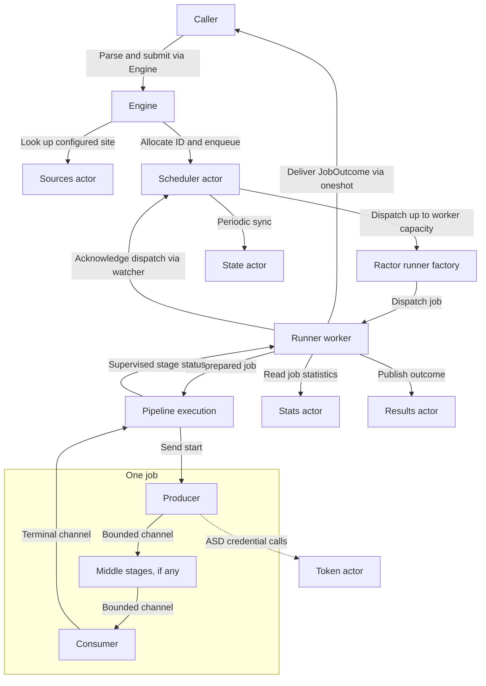

# Engine pipeline design

This document describes the pipeline in the `fetiche-engine` crate. See [Architecture](../../docs/ARCHITECTURE.md) for
the broader repository layout. The implementation under [
`../../cmd/fetiched/src/engine`](../../cmd/fetiched/src/engine/mod.rs) has its own execution path and is outside this
document's scope.

## Engine entry points

The crate root exports `Engine`, `EngineConfig`, and the job and stage types. The configuration schema and its
validation live in [config.rs](../src/config.rs). The [engine module](../src/engine/mod.rs) holds the engine handle
and its path accessors. Its files cover [startup and rollback](../src/engine/startup.rs),
[state sync and shutdown](../src/engine/lifecycle.rs), [job parsing](../src/engine/parse.rs),
[job submission and control](../src/engine/jobs.rs), [catalogs](../src/engine/catalog.rs), and
[token actor calls](../src/engine/tokens.rs).

## Authoritative completion

The pipeline drains terminal output while monitoring every stage's Tokio join handle. Success requires all stages to
return successfully. A stage error or panic records the stage's position and name, aborts remaining stages, and waits for
their tasks to exit. Cancellation reported by a task carries its stage label. Engine-wide cancellation has no stage
label. Output written before a failure is retained.

`WaitGroup::rx` is a Tokio oneshot receiver for `JobOutcome`, which carries the job ID, terminal status, and
statistics snapshot. The results actor acknowledges storage before the caller is notified on the normal path.
`Work` dropped before publication reports cancellation directly to its waiter.
`submit_job_and_wait` returns statistics on success and reports failed or cancelled outcomes as errors.

[Pipeline](../src/pipeline.rs), [Runner](../src/actors/runner.rs), [Outcome types](../src/job.rs), [Results](../src/actors/results.rs)

## Backpressure and blocking work

Pipeline edges use bounded Tokio MPSC channels. A full edge suspends the sending stage or source adapter until its
receiver makes room. Each stage inherits its input channel's capacity when it creates the next channel. Senhive
requests an AMQP prefetch of one delivery per feed to limit buffering ahead of the pipeline.

Set these optional values at the top level of `engine.hcl`. The example shows the defaults.

```hcl
pipeline_queue_capacity = 16
read_max_bytes          = 67108864
```

`pipeline_queue_capacity` limits queued messages per edge. The default is a starting point. Use representative
message sizes and sink throughput when tuning it. A stage can also hold an in-flight message. Network fetchers can
materialize a full source response, so the queue capacity does not establish a job-wide byte limit.

A `Read` stage sends one UTF-8 payload to preserve the file boundaries expected by consumers such as `Save`.
`read_max_bytes` sets the maximum input size for HCL jobs. An oversized file fails the stage before it emits a
payload. Programmatically built stages use the same default and can override it with `Read::max_bytes`.

`Tee` awaits file writes and flushes before forwarding. Parquet output, batch conversion, standalone ASD token file
access, and sink console writes use Tokio's blocking executor. Engine-run ASD token access goes through the token
actor. A blocking operation already in progress can finish after its stage is cancelled.

[Engine configuration](../src/config.rs), [Stage wrapper](../../macros/src/lib.rs), [Read](../src/producer/read.rs),
[Tee](../src/middle/tee.rs), [Save](../src/consumer/save.rs), [Senhive feed](../src/sources/adapters/senhive/feed.rs)

## Scheduler dispatch

The scheduler dispatches waiting jobs in FIFO order up to the configured runner count. A tick or resume can fill
available slots. The scheduler sends factory messages without waiting for execution in its mailbox, so status,
submission, and suspension commands remain available while a stream runs. Suspension pauses new dispatches and
allows active jobs to finish.

A watcher outside the mailbox turns the runner's reply or a dropped reply port into a completion message keyed
by job ID. The scheduler releases that slot and refills it if dispatch is active. The job waiter still receives its
typed outcome from the runner or the dropped work. Results remain in the results actor. The scheduler reports
whether waiting and dispatched work are empty independently of retained results.

Queued jobs can be removed by ID and receive a cancellation outcome. Removal of dispatched jobs returns an
error. Duplicate IDs are rejected while a job is outstanding. [Scheduler](../src/actors/scheduler.rs), [Runner](../src/actors/runner.rs),
[Engine commands](../src/engine/jobs.rs)

## Workspace and shutdown ownership

Both submission methods resolve relative `Read`, `Tee`, and `Save` paths against the engine workspace without
changing the process working directory. The HCL parser uses the same workspace for `Store` before it creates
the destination directory. Absolute paths and stdout output keep their configured meaning.

An explicit engine configuration path selects its containing directory for sources, tokens, and state. Each engine
claims its workspace with an exclusive `running` marker. A pre-existing marker prevents a new claim. If startup
fails after claiming the workspace, the engine joins actors already started and releases the marker after cleanup.

Clones share one lifecycle owner. Shutdown closes scheduler admission, cancels waiting jobs, and lets dispatched
jobs finish within the grace period. The default is five seconds. The first `shutdown_with_timeout` caller can
choose another grace period. After the deadline, the engine signals cancellation and the runner aborts and joins
its stages. Shutdown acknowledges a final state write and joins the engine actors before removing the marker.
The engine retains the marker if it cannot confirm actor exit. Single-mode cleanup detaches the owned workspace
before deleting it. A Tokio blocking operation that has already started can still finish after cancellation.

[Workspace paths](../src/workspace.rs), [Startup](../src/engine/startup.rs), [Lifecycle](../src/engine/lifecycle.rs),
[Shutdown](../src/engine/lifecycle.rs), [Public API tests](../tests/lifecycle.rs)

## Configuration schema

`engine.hcl` requires the following top-level fields and accepts the optional runtime overrides below.

| Field | Required | Type and effective default |
|---|---|---|
| `version` | Yes | Integer. Startup requires `3`. |
| `basedir` | Yes | Path string. Workspaces are under `<basedir>/var/run/<pid>` in single mode and `<basedir>/var/run/acute` in daemon mode. |
| `storage` | Yes | Map of named storage areas. Use `storage = {}` for an empty registry. |
| `workers` | No | Positive integer. Daemon mode defaults to available parallelism, or one if it cannot be determined. Single mode uses one. |
| `tick` | No | Positive duration in the form `{ secs = 2, nanos = 0 }`. Daemon mode defaults to two seconds. Single mode uses one second. |
| `sync` | No | Positive duration in the same form. Daemon mode defaults to 30 seconds. Single mode uses 30 seconds. |
| `pipeline_queue_capacity` | No | Integer from one through Tokio's semaphore limit. Defaults to 16 messages per edge in either mode. |
| `read_max_bytes` | No | Positive integer that fits in `u32`. Defaults to 67,108,864 bytes (64 MiB) for HCL `Read` stages. |

Explicit worker and timer settings are validated in either mode. Startup logs the effective settings. A bare
configuration filename is looked up in the default configuration directory. For an explicit path, the configuration
file's canonical parent supplies `sources.hcl`, `tokens/`, and `state`. Startup expects the sources file and token
directory to exist. A missing state file starts with an empty snapshot.
[Engine schema](../src/config.rs), [Configuration example](../src/engine.hcl), [Startup](../src/engine/startup.rs)

Storage area entries are selected by their fields. Unknown fields within an area are rejected.

| Entry shape | Registration behavior |
|---|---|
| `{ path = "...", rotation = "1h" }` | Creates or verifies a local directory and records a rotation interval. |
| `{ path = "..." }` | Registers a Hive area and creates or verifies its local directory. |
| `{ url = "..." }` | Registers a cache URL. Registration does not connect to a cache. |

Rotations are positive whole numbers with an `s`, `m`, `h`, or `d` suffix. The resulting seconds must fit in `u32`.
Use absolute paths for storage areas to make their location independent of the process working directory. Directory
errors keep the underlying I/O cause. The storage registry is separate from the job's `Store` stage, which takes a
destination directory and a frequency directly. [Storage schema](../src/storage.rs), [Store stage](../src/consumer/store.rs)

`sources.hcl` declares `version = 4` in the shipped configuration. The loader requires an integer version field
and a site map. It deserializes the version without comparing it to 4. Use labeled `site "name" { … }` blocks
or `site = {}` for an empty registry. Each site requires `feature`, `type`, `format`, and `base_url`.
`feature` selects the capability, such as `fetch` or `stream`, and `type` describes the data, such as `drone` or
`adsb`. The optional fields are `auth`, `routes`, `variant`, and `token_base`. Authentication and route keys depend
on the provider. The loader derives the site name from the registry key and resolves relative `token_base` paths
against the configuration directory. An omitted `token_base` defaults to that directory.
[Source schema](../src/sources/config.rs), [Site fields](../src/sources/site.rs),
[Source examples](../src/sources/sources.hcl)

### Token storage

Token registration and lookup report unsupported filenames, malformed data, missing tokens, and read failures
separately. Synchronous token methods return errors and run outside Tokio for standalone storage.
Inside the engine, the linked token actor owns
the storage and serializes reads, writes, and listings. Engine clones share its mailbox, and engine shutdown stops
the actor. Engine-run ASD fetches use the same token operations and the engine configuration directory's `tokens/`
store. ASD fetches using the same login share the `asd_default_token-<login>` key within one engine.
Standalone ASD authentication uses the source's `token_base`. The ASD token format remains readable when
the network adapter is disabled. New engine token files are written at the storage root, and older nested files
can still be read. [Storage](../src/storage.rs), [Tokens](../src/actors/tokens.rs)

## Architecture and startup

The engine uses Ractor actors on Tokio to configure, schedule, and observe jobs. Each job is an ordered chain with one
producer, zero or more middle stages, and one consumer. Stages execute concurrently, while each individual stage
processes its own inputs serially.



[`Engine::load`](../src/engine/startup.rs) loads and checks the version of `engine.hcl`, creates the work directory and its
`running` marker, and starts the supervisor. Statistics, sources, state, results, token storage, the runner factory,
and the scheduler start as linked actors in that order. Startup also registers storage areas. Single mode uses one
runner and a one-second tick. Daemon mode uses the configured worker count or the available CPU parallelism, a two-second default tick, and a
30-second default state sync. The supervisor logs lifecycle events. Its handler implements no restart
policy. [Supervisor](../src/actors/supervisor.rs)

## Job schema and execution

A job definition requires `name` (a string), `producer`, and `output`. The optional `middle` list defaults to
empty. Stage variant names use the casing shown below.

| Field | Accepted forms |
|---|---|
| `producer` | `{ Read = "input.csv" }`, `{ Fetch = ["site", filter] }`, or `{ Stream = ["site", filter] }` |
| `middle` entries | `"Copy"` or `{ Tee = "copy.csv" }` |
| `output` | `{ Save = "output.csv" }`, `{ Save = "-" }` for stdout, or `{ Store = ["directory", "Hourly"] }` with `"Hourly"` or `"Daily"` |

`Read` requires a nonempty literal string. The parser does not evaluate expressions or interpolate templates in file
paths. It rejects the reserved HCL variants `Convert` and `Archive` before marking the job ready. `Store` attempts
to create a job-specific directory under the specified destination during parsing.
[Job parser](../src/engine/parse.rs), [Store constructor](../src/consumer/store.rs)

The source filter is a signed integer duration in seconds or an object with one of the following field sets.
`{ begin, end }` takes timestamp strings, `{ name, value }` takes strings, `{ duration, min, max }` takes unsigned
integers, and `{ from, duration, delay }` takes a signed `from` and unsigned `duration` and `delay`. A null filter
represents no filter at the schema level. Each adapter determines which filters it accepts and how it interprets them.
[Filter schema](../../common/src/filter.rs)

```hcl
name     = "copy a local file"
producer = { Read = "input.csv" }
middle   = ["Copy", { Tee = "copy.csv" }]
output   = { Save = "output.csv" }
```

Registry lookups and pipeline producers share the fetch and stream adapter selectors. A missing registry name
returns `UnknownSite`. A known site with an unsupported or disabled adapter returns `InvalidSite`. For Avionix
`cubedata`, an explicit variant chooses the server or local Cube. With no variant, user and API keys select the
server, and anonymous or omitted authentication selects the local Cube. [Source selectors](../src/sources/selection.rs)

Source HCL loading attaches site names and resolves configured paths. The registry holds those sites and handles
lookup and listing. Provider-specific code, including provider-owned actors and token types, lives under adapters.
[Source configuration](../src/sources/config.rs), [Registry](../src/sources/registry.rs), [Adapters](../src/sources/adapters/mod.rs)

1. **Parse and resolve.** `Engine::parse` deserializes the job name, producer, optional `middle` list, and `output`, and
   asks the scheduler for an ID. For `Fetch` and `Stream`, it resolves the named site through the sources actor and
   checks the requested capability. The producing stage resolves the actual feature-gated adapter when it runs.
   `Read` uses a file path. The parser builds a `Ready` job with concrete stage enum
   variants. The job shape enforces producer, middle, and consumer positions, while individual variants determine what
   processing is available. [Parser](../src/engine/parse.rs), [Job model](../src/job.rs)
2. **Submit.** `Engine::submit_job` and the scheduler check for `JobState::Ready`. The scheduler enqueues a `Work`
   containing the job and a completion sender. It returns a `WaitGroup` with the job ID and a Tokio oneshot receiver.
   `submit_job_and_wait` awaits that outcome directly. [Engine commands](../src/engine/jobs.rs), [Scheduler](../src/actors/scheduler.rs)
3. **Dispatch.** A tick, start or resume, or completion can fill free worker slots. The scheduler sends each job to
   the factory and tracks its ID. A separate task watches for the dispatch acknowledgement or a closed reply port.
   [Scheduler](../src/actors/scheduler.rs), [Factory setup](../src/engine/startup.rs)
4. **Wire and start.** The runner attaches engine dependencies, including the token actor for ASD fetches, and
   delegates execution to the pipeline. The pipeline flattens the producer, middle stages, and consumer into an
   ordered `Task` list. It creates the first channel, then passes each stage's output receiver to the next stage's
   `Runnable::run`. Once the chain is wired, the pipeline sends `"start"` and drops the input sender. The producer's
   `execute` uses that message as a trigger and obtains its payload from the configured
   source. [Pipeline](../src/pipeline.rs), [Task contract](../src/task.rs)

## Stage execution and data flow

`Runnable::run` returns an output receiver and a Tokio join handle. The `RunnableDerive` proc macro clones the concrete
stage into a `tokio::spawn` task and creates a bounded Tokio MPSC output channel with the input channel's capacity.
It awaits input and calls `execute(data, sender.clone())` for each string. The stage can emit zero, one, or many
strings per invocation. A stage error becomes the task's error result, and a successful return value is discarded.
[Derive macro](../../macros/src/lib.rs)

| Position | Examples and behavior                                                                                                                                                                                                                            |
|----------|--------------------------------------------------------------------------------------------------------------------------------------------------------------------------------------------------------------------------------------------------|
| Producer | `Read` sends the entire file as one UTF-8 string. `Fetch` delegates to a source adapter after authentication. `Stream` delegates to a streaming adapter, which controls delivery and how long the producer holds its output sender.              |
| Middle   | `Copy` forwards data. `Tee` appends a copy to a file before forwarding. The `Middle` enum includes other stages for programmatic composition.                                                                                                    |
| Consumer | `Save` writes to stdout or a file. A raw file write replaces the file contents on each message. `Store` appends and flushes to a UTC hour or day bucket under its job directory. These sinks consume their input without sending a payload to the terminal receiver. |

[Producers](../src/producer/mod.rs), [Read](../src/producer/read.rs), [Middle stages](../src/middle/mod.rs), [Tee](../src/middle/tee.rs), [Save](../src/consumer/save.rs), [Store](../src/consumer/store.rs)

Each receive loop ends after all upstream sender clones have been dropped and buffered messages have been drained. When
the task exits, its output sender drops, allowing closure to propagate downstream. A streaming adapter that retains a
sender keeps that edge open. The pipeline drains and discards any terminal messages while polling stage joins and
the shutdown cancellation signal. File sinks normally close the terminal receiver without emitting data.
[Pipeline execution](../src/pipeline.rs)

Both [`simple.rs`](../examples/simple.rs) and [`simple_tokio.rs`](../examples/simple_tokio.rs) demonstrate the same
receiver handoff. The threaded example runs blocking receives on dedicated threads with unbounded standard channels.
The Tokio example resembles the engine's bounded channels, asynchronous output drain, and stage joins.

## Completion, state, and shutdown

The runner creates a `job#<id>` statistics entry before starting the pipeline. After stage execution settles, it
reads and resets that entry, submits the outcome to the results actor, delivers it through the job's oneshot, and
acknowledges dispatch separately. If publication fails after an otherwise successful pipeline, the waiter receives
a failure. A results lookup returns the stored outcome or `None`. `Engine::wait_for` performs one results lookup
and reports a missing outcome as an error. Producer return values such as `Read`'s `Stats` are discarded by the
stage wrapper. Source adapters can record metrics under their own tags, so the job snapshot can omit source work.
[Runner](../src/actors/runner.rs), [Results](../src/actors/results.rs), [Statistics](../src/actors/stats.rs),
[Job APIs](../src/engine/jobs.rs), [FlightAware stream](../src/sources/adapters/flightaware/stream.rs)

The scheduler owns live queue membership and retires jobs by ID. The state actor stores a separate JSON snapshot.
At startup it reads the current snapshot or migrates the previous format, clears queue collections, and supplies
its recorded ID counter to the scheduler. The snapshot provides bookkeeping without durable job replay. Completed
outcomes stay in memory in the results actor. [Scheduler](../src/actors/scheduler.rs), [State](../src/actors/state.rs)

Shutdown closes admission, settles dispatched work through completion or cancellation, and requests an acknowledged
state flush. Actor teardown is attempted even if draining or flushing fails. The marker is removed after actor exit
is confirmed. The workspace and shutdown section describes grace periods and ownership.
[Shutdown implementation](../src/engine/lifecycle.rs)

## Strengths

- **Simple composition.** The linear topology and job shape make stage order easy to inspect. A job author can change a
  source, insert a forwarding stage, or change the destination without rewriting the runner.
- **Local ownership and ordering.** Each task owns its stage and input receiver. A single receive loop preserves the
  order observed on that channel, and downstream processing can overlap with upstream I/O.
- **Small stage contract.** The derive macro centralizes channel wiring. Stage implementations can be exercised directly
  with a test sender, as the `Read`, `Tee`, and `Store` tests do.
- **Separate orchestration and I/O.** Actor messages handle scheduling, source discovery, state, and statistics.
  Payloads travel directly between stages without routing every record through the scheduler or factory.

## Weaknesses and tradeoffs

| Area | Consequence |
|---|---|
| Blocking work | File and CPU-heavy work offloaded to Tokio's blocking executor can keep running after the stage is cancelled. |
| Memory and flow control | Capacity limits count messages per edge. Whole-file reads and adapter response buffers can still dominate memory. |
| Failure and cancellation | A failed or cancelled job can leave partial output. The engine's cancellation signal coordinates shutdown. Individual dispatched jobs cannot be removed through `remove_job`. |
| Job state and capacity | The in-memory waiting queue and result collection have no retention or admission limit. The separate state snapshot does not replay jobs after restart. |
| Validation and sink semantics | The parser checks stage kinds and site capabilities. Actual adapter construction happens when the producer runs. Text payloads leave format and framing implicit. Raw `Save` replaces the file on each message, and a retry of an append sink can duplicate output already written. |
| Observability | Stage success values can contain counters that never enter the job-tag snapshot. Queue-pressure metrics would help explain slow stages and tune capacity. |

[Parser](../src/engine/parse.rs), [Scheduler](../src/actors/scheduler.rs), [Pipeline](../src/pipeline.rs),
[Runner](../src/actors/runner.rs), [Derive macro](../../macros/src/lib.rs), [Save](../src/consumer/save.rs)

## Possible improvements

1. **Bound admission and result retention.** Set policies for how many jobs can wait and how long completed outcomes
   remain queryable. Clarify the role of the state snapshot or add durable job records if replay becomes a requirement.
2. **Measure pressure and constrain large payloads.** Track queue occupancy, send wait times, byte and record counts, and
   stage exits under the job ID. Use measured payload sizes and sink throughput to tune channel capacity. If whole-file
   reads dominate memory, define chunk or batch limits that preserve input framing.
3. **Extend cancellation and timeout controls.** Decide whether callers should be able to cancel a dispatched job by ID
   or set a job deadline. Preserve typed outcomes and document how cancellation interacts with blocking operations.
4. **Validate compatibility and define sink behavior.** Where possible, validate adapter availability and format
   expectations before scheduling. If binary data or batches become common, introduce payloads with explicit format and
   boundaries. Define publication and retry guarantees for overwrite and append sinks.
5. **Extend lifecycle coverage.** The existing tests cover bounded channels, stage errors and panics, out-of-order
   completion, and shutdown. Add a full slow-sink or idle-source scenario when changing network adapters or sinks to
   check responsiveness, cancellation, and partial output together.
